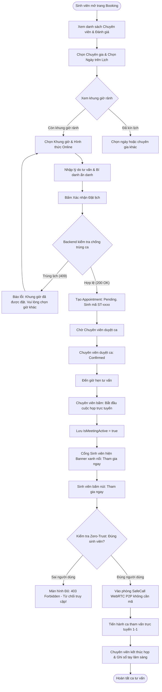

# 04. USE CASE SPECIFICATIONS & USER FLOWS
**Tài liệu theo chuẩn Sổ tay Quy trình AI Agent Web App 15 bước — Mẫu 04 & Bước 06**  
**Dự án:** UniMind — Nền tảng Nhật ký Cảm xúc & Hỗ trợ Tư vấn Tâm lý Ẩn danh Dành cho Sinh viên  
**Học phần:** Phát triển Ứng dụng (PTUD) — ĐH Lạc Hồng  

---

## 1. Danh mục Use Case cốt lõi

```
                               ┌────────────────────────┐
                               │     HỆ THỐNG UNIMIND   │
                               └───────────┬────────────┘
           ┌───────────────────────────────┼───────────────────────────────┐
           ▼                               ▼                               ▼
   [ Phân hệ Sinh viên ]          [ Phân hệ Chuyên viên ]         [ Phân hệ Quản trị ]
  - UC-001: Đăng ký / Đăng nhập  - UC-005: Quản lý lịch trực     - UC-008: Quản lý người dùng
  - UC-002: Viết nhật ký & AI    - UC-006: Duyệt ca & Mở họp     - UC-009: Phân quyền chuyên gia
  - UC-003: Trắc nghiệm tâm lý   - UC-007: Ghi sổ tay lâm sàng   - UC-010: Quản lý từ khóa AI
  - UC-004: Cộng đồng & Ảnh FB   - UC-008: Kiểm duyệt nội dung   - UC-011: Hàng đợi Báo động đỏ
  - UC-005: Đặt lịch tư vấn      - UC-009: Tham vấn WebRTC       - UC-012: Tra cứu Audit Log
  - UC-006: Vào họp trực tuyến
```

---

## 2. Đặc tả Use Case chi tiết

### UC-005: Đặt lịch hẹn tư vấn tâm lý (Chống trùng lịch)

| Thuộc tính | Chi tiết đặc tả |
| :--- | :--- |
| **Mã Use Case** | **UC-005** |
| **Tên Use Case** | Đặt lịch hẹn tư vấn tâm lý (Consultation Appointment Booking) |
| **Actor chính** | Sinh viên đã đăng nhập (ACT-STU) |
| **Tiền điều kiện** | Sinh viên đã có tài khoản hợp lệ, đã đăng nhập và đang mở trang `/student/booking`. Chuyên viên đã có ít nhất một khung giờ rảnh chưa bị đặt (`IsBooked = 0`). |
| **Kích hoạt (Trigger)** | Sinh viên bấm nút chọn khung giờ trên lịch của chuyên viên và nhấn *"Tiếp tục đặt lịch"*. |
| **Luồng chính (Happy Path)** | 1. Sinh viên xem danh sách chuyên gia (học hàm, chuyên môn, đánh giá sao, số ca đã tư vấn).<br>2. Chọn chuyên viên muốn tư vấn.<br>3. Chọn ngày trên lịch; hệ thống hiển thị danh sách các khung giờ rảnh khả dụng của chuyên viên trong ngày đó.<br>4. Sinh viên chọn hình thức tư vấn (Trực tuyến SafeCall hoặc Trực tiếp tại phòng P.302).<br>5. Sinh viên nhập lý do tư vấn (tùy chọn hoặc tóm tắt nỗi lo) và bí danh mong muốn.<br>6. Bấm nút *"Xác nhận đặt lịch hẹn"*.<br>7. Hệ thống mở giao dịch cơ sở dữ liệu:<br>   - Kiểm tra lại xem khung giờ đã bị người khác đặt chưa.<br>   - Đánh dấu khung giờ `IsBooked = 1`.<br>   - Tạo bản ghi mới trong bảng `Appointments` với trạng thái `Pending` và mã tra cứu `ST-xxxx`.<br>8. Hệ thống hiển thị hộp thoại thông báo thành công kèm mã tra cứu và điều hướng sinh viên về tab lịch hẹn cá nhân. |
| **Luồng thay thế (Alternative)** | - **A1:** Sinh viên chưa hoàn thành bài test DASS-21: Hệ thống hiển thị thông điệp gợi ý *"Bạn có thể làm nhanh bài test DASS-21 để chuyên viên nắm trước tình trạng của bạn"*, kèm nút liên kết đến trang test.<br>- **A2:** Sinh viên muốn hủy ca hẹn đang chờ duyệt: Sinh viên có thể bấm *"Hủy yêu cầu"*, hệ thống cập nhật ca hẹn sang `Cancelled` và giải phóng khung giờ (`IsBooked = 0`). |
| **Ngoại lệ (Exceptions)** | - **E1 (Trùng lịch đồng thời - Concurrency Conflict):** Có sinh viên khác vừa nhanh tay bấm đặt thành công khung giờ đó trước 1 phần nghìn giây. Hệ thống bắt lỗi `UniqueConstraintException`, rollback giao dịch và trả về thông báo lỗi: *"Khung giờ này vừa được người khác đăng ký. Vui lòng chọn khung giờ khác!"*.<br>- **E2 (Phiên đăng nhập hết hạn):** Token JWT hết hạn -> Hệ thống lưu tạm dữ liệu form vào local storage và chuyển hướng sinh viên về trang `/login`. |
| **Hậu điều kiện** | Bản ghi `Appointments` được lưu một lần duy nhất; khung giờ `TimeSlots.IsBooked` chuyển thành 1; chuyên viên nhận được thông báo ca hẹn mới. |
| **Ghi nhận Audit Log** | Hành động `CREATE_APPOINTMENT` được ghi nhận với ID sinh viên, ID chuyên gia, mã ca hẹn và địa chỉ IP. |

---

### UC-006: Khởi tạo & Tham gia phòng tư vấn trực tuyến SafeCall (Không cần mã mời)

| Thuộc tính | Chi tiết đặc tả |
| :--- | :--- |
| **Mã Use Case** | **UC-006** |
| **Tên Use Case** | Khởi tạo & Tham gia phòng tư vấn trực tuyến (SafeCall Direct Consultation Room) |
| **Actor chính** | Chuyên viên tâm lý (ACT-EXP) & Sinh viên (ACT-STU) |
| **Tiền điều kiện** | Ca hẹn ở trạng thái `Confirmed` hoặc `Approved`; hình thức là `Online`; thời điểm hiện tại trùng với khung giờ hẹn. |
| **Kích hoạt (Trigger)** | Chuyên viên bấm nút *"🌐 Bắt đầu cuộc họp trực tuyến"* trên màn hình `/expert/consultation`. |
| **Luồng chính (Happy Path)** | 1. Chuyên viên bấm nút *"🌐 Bắt đầu cuộc họp trực tuyến"* tại ca hẹn tương ứng.<br>2. Hệ thống cập nhật bản ghi lịch hẹn: `IsMeetingActive = true`, `MeetingStartedAt = DateTime.UtcNow`.<br>3. Trên cổng giao diện của Sinh viên (`StudentLayout.jsx`), bộ theo dõi sự kiện phát hiện có cuộc họp của mình đang mở.<br>4. Màn hình của Sinh viên hiển thị ngay một **Banner nổi màu xanh lá**: *"Chuyên viên đang đợi bạn! Cuộc họp đang mở"* kèm nút bấm *"🎥 Tham gia ngay"*.<br>5. Sinh viên bấm nút *"🎥 Tham gia ngay"*, hệ thống chuyển hướng sinh viên vào `/student/meeting-room?appointmentId=...`.<br>6. Hệ thống thực hiện kiểm tra bảo mật Zero-Trust: xác minh người dùng hiện tại chính là sinh viên sở hữu ca hẹn.<br>7. Trình duyệt khởi tạo kết nối P2P WebRTC trực tiếp giữa Chuyên viên và Sinh viên (bật camera, micro, nút chia sẻ màn hình, nút ngắt máy).<br>8. Hai bên tiến hành phiên tham vấn trực tuyến an toàn, riêng tư 100%. |
| **Luồng thay thế (Alternative)** | - **A1 (Chuyên viên kết thúc cuộc họp):** Chuyên viên bấm nút *"Kết thúc ca tư vấn"*, hệ thống cập nhật `IsMeetingActive = false`, chuyển hướng chuyên viên sang form nhập *"Ghi chú lâm sàng"*.<br>- **A2 (Sinh viên xin tắt camera):** Sinh viên có thể chủ động bấm tắt camera để chỉ trao đổi bằng giọng nói nếu cảm thấy e ngại. |
| **Ngoại lệ (Exceptions)** | - **E1 (Truy cập trái phép - Zero-Trust Violation):** Một tài khoản sinh viên khác hoặc người lạ có được URL phòng họp và cố tình truy cập. Hệ thống kiểm tra: `CurrentUserId != Appointment.StudentId`. Lập tức chặn kết nối, không cấp stream WebRTC, hiển thị màn hình đỏ cảnh báo: **`403 Forbidden — Bạn không có quyền tham gia cuộc họp này!`**.<br>- **E2 (Lỗi thiết bị âm thanh/hình ảnh):** Trình duyệt không có quyền truy cập mic/cam -> Hiển thị hướng dẫn cấp quyền trình duyệt. |
| **Hậu điều kiện** | Phiên gọi WebRTC được kết nối bảo mật; không lưu bất kỳ video/audio nào tại máy chủ; nhật ký thời gian bắt đầu và kết thúc được lưu trong `Appointments`. |
| **Ghi nhận Audit Log** | Ghi nhận sự kiện `START_CONSULTATION_ROOM` và `END_CONSULTATION_ROOM`. |

---

### UC-004: Đăng bài chia sẻ 2 cột & Bình luận ảnh chuẩn Facebook

| Thuộc tính | Chi tiết đặc tả |
| :--- | :--- |
| **Mã Use Case** | **UC-004** |
| **Tên Use Case** | Chia sẻ tâm sự 2 cột (Live Preview) & Bình luận đa phương tiện (Community Interaction) |
| **Actor chính** | Sinh viên (ACT-STU), Chuyên viên (ACT-EXP), Admin (ACT-ADM) |
| **Tiền điều kiện** | Người dùng đã đăng nhập; tài khoản đang ở trạng thái kích hoạt (`IsActive = 1`). |
| **Kích hoạt (Trigger)** | Sinh viên bấm vào khung *"Bạn đang cảm thấy thế nào hôm nay?"* tại `/student/community`. |
| **Luồng chính (Happy Path)** | 1. Giao diện mở ra layout soạn thảo **2 cột song song**:<br>   - **Cột trái:** Sinh viên nhập nội dung, chọn 1 trong 5 danh mục (*Góc học tập, Gia đình & Bạn bè, Chuyện thường ngày, Góc tâm sự, Định hướng & Tương lai*), chọn màu nền pastel/gradient, chọn ảnh thiên nhiên hoặc đính kèm ảnh.<br>   - **Cột phải:** Hiển thị tức thì bản xem trước (**Live Preview**) bài đăng thực tế.<br>2. Sinh viên bấm nút *"Đăng bài"*.<br>3. Hệ thống chuyển nội dung qua bộ máy AI Sentiment & Bộ lọc từ khóa nhạy cảm:<br>   - Nếu an toàn: Đăng bài thành công, bài viết hiển thị ngay trên bảng tin dưới bí danh ẩn danh.<br>4. Người dùng khác xem bài, bấm nút *"Bình luận"* nằm ở cụm bên trái cùng với *"Thích"* và *"Đồng cảm"*.<br>5. Người dùng nhập bình luận, bấm biểu tượng 📷 để đính kèm ảnh từ máy tính (xem trước ảnh thu nhỏ kèm nút `✕` xóa).<br>6. Ảnh được tải lên Cloudinary, bình luận được lưu và hiển thị dạng bong bóng bo tròn mềm mại chuẩn Facebook. |
| **Luồng thay thế (Alternative)** | - **A1 (Chuyên viên bình luận):** Chuyên viên tham gia bình luận động viên -> Hệ thống tự động gắn nhãn huy hiệu uy tín: *"Chuyên viên Tâm lý 🎓"*.<br>- **A2 (Lọc theo chủ đề):** Người dùng bấm vào nút lọc danh mục -> Hệ thống sử dụng cơ chế Alias tự động gom cả các bài viết cũ và mới. |
| **Ngoại lệ (Exceptions)** | - **E1 (Phát hiện từ khóa tự hại hoặc tiêu cực cao):** Nội dung chứa từ khóa nhạy cảm hoặc $RiskScore \ge 75$. Hệ thống tự động chuyển bài viết/bình luận sang trạng thái `Flagged`, ẩn khỏi sinh viên thông thường (`IsSensitiveHiddenFromStudents = true`), thông báo nhẹ nhàng cho người viết: *"Nội dung đang được kiểm duyệt bởi chuyên gia tâm lý"*, đồng thời đẩy cảnh báo khẩn vào `NlpRiskAlerts`.<br>- **E2 (Upload ảnh quá dung lượng):** Ảnh vượt quá 5MB -> Hệ thống từ chối và yêu cầu chọn ảnh nhỏ hơn. |
| **Hậu điều kiện** | Bài viết/bình luận được lưu trữ an toàn; số lượng comment/like được cập nhật nguyên tử; danh tính thật của sinh viên được giữ kín 100%. |
| **Ghi nhận Audit Log** | Khi có cảnh báo tự hại, hệ thống tự động ghi nhật ký `FLAG_SENSITIVE_CONTENT`. |

---

## 3. Sơ đồ User Flow điều hướng màn hình

### User Flow: Đặt lịch và Tham gia ca tư vấn trực tuyến


