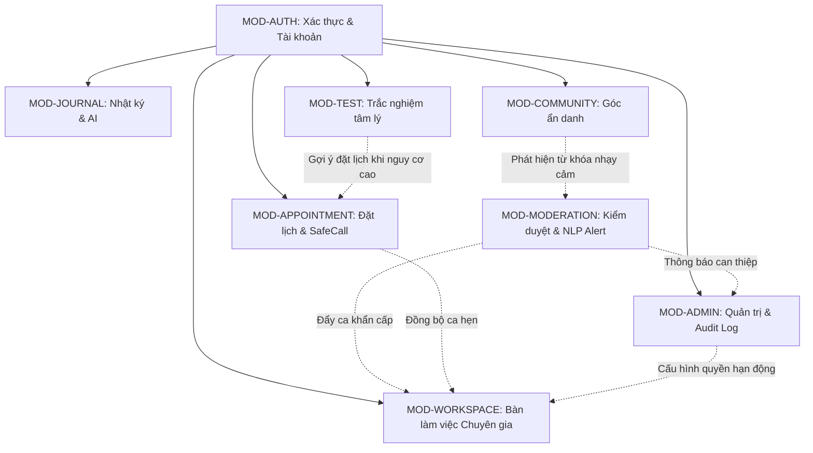

# 01. MODULE DECOMPOSITION & MAP
**Tài liệu theo chuẩn Sổ tay Quy trình AI Agent Web App 15 bước — Mẫu 05 & Bước 07**  
**Dự án:** UniMind — Nền tảng Nhật ký Cảm xúc & Hỗ trợ Tư vấn Tâm lý Ẩn danh Dành cho Sinh viên  
**Học phần:** Phát triển Ứng dụng (PTUD) — ĐH Lạc Hồng  

---

## 1. Nguyên tắc phân chia Module
Không phân chia Module theo từng Actor riêng biệt (tránh trùng lặp logic và phân mảnh cơ sở dữ liệu). Thay vào đó, toàn bộ hệ thống được phân rã thành **8 Module nghiệp vụ độc lập**, mỗi module sở hữu một ranh giới dữ liệu (*Data Boundary*) rõ ràng và phục vụ nhiều Actor với các quyền hạn khác nhau theo chuẩn Clean Architecture.

---

## 2. Bản đồ Module (Module Map)

| Mã Module | Tên Module | Trách nhiệm chính | Không chịu trách nhiệm | Thực thể dữ liệu (Entities) | Actor sử dụng |
| :--- | :--- | :--- | :--- | :--- | :--- |
| **MOD-AUTH** | Xác thực & Quản lý Tài khoản | Đăng ký (nhập khóa học tự do), đăng nhập JWT, giải mã phiên, cấp bí danh ẩn danh ngẫu nhiên, đổi mật khẩu. | Không quản lý phân quyền chức năng sâu của chuyên gia; không ghi nhận ca hẹn. | `Users` | Sinh viên, Chuyên viên, Quản trị viên |
| **MOD-JOURNAL** | Nhật ký Cảm xúc & AI Sentiment | Ghi chép tâm trạng cá nhân (Great, Peaceful, Stressed,...), mức năng lượng (1-10), gọi AI phân tích điểm cảm xúc (-1 đến +1), trả phản hồi thấu cảm và bài tập thở, vẽ biểu đồ 7 ngày. | Không xuất bản bài viết công khai (chỉ là không gian riêng tư); không xử lý ca tư vấn. | `MoodJournals` | Sinh viên (riêng tư 100%) |
| **MOD-TEST** | Ngân hàng Trắc nghiệm Tâm lý | Quản lý câu hỏi, lựa chọn và thang đo chuẩn quốc tế DASS-21 (x2 Lovibond), PHQ-9, GAD-7; tính điểm, phân tầng mức độ và cảnh báo vượt ngưỡng an toàn. | Không quản lý lịch hẹn (chỉ điều hướng gợi ý sang MOD-APPOINTMENT). | `PsychologicalTests`, `TestQuestions`, `TestOptions`, `TestResults` | Sinh viên, Quản trị viên |
| **MOD-COMMUNITY** | Diễn đàn Ẩn danh & Tương tác | Đăng bài 2 cột có Live Preview; lọc 5 chủ đề thân thiện; bình luận kèm ảnh chuẩn Facebook tải lên Cloudinary; cụm tương tác Thích, Đồng cảm bên trái; ẩn danh hóa tác giả 100%. | Không trực tiếp can thiệp y khoa (chỉ là không gian chia sẻ đồng trang lứa). | `CommunityPosts`, `CommunityComments` | Sinh viên, Chuyên viên, Quản trị viên |
| **MOD-APPOINTMENT** | Đặt lịch & Tham vấn Trực tuyến SafeCall | Quản lý lịch rảnh chuyên gia, đặt lịch hẹn có kiểm tra chống trùng ca tư vấn (Anti-double-booking), tự động hiển thị banner nổi mở phòng họp P2P WebRTC không cần mã mời, kiểm soát Zero-Trust. | Không can thiệp chẩn đoán nội dung cuộc họp (chỉ quản lý kết nối và phiên). | `Appointments`, `TimeSlots` | Sinh viên, Chuyên viên |
| **MOD-WORKSPACE** | Không gian Làm việc Chuyên gia | Quản lý ca trực, phê duyệt/từ chối lịch hẹn, xem tóm tắt trắc nghiệm DASS-21 của sinh viên trước buổi tư vấn, ghi sổ tay chẩn đoán lâm sàng sau ca hẹn, xem phân tích xu hướng. | Không quản lý cấu hình người dùng toàn hệ thống (thuộc Admin). | `Experts`, `Appointments`, `TimeSlots` | Chuyên viên tâm lý |
| **MOD-MODERATION** | Kiểm duyệt AI & Báo động đỏ | Phân tích song song từ điển từ khóa nhạy cảm và LLM Gemini; tự động gắn cờ (`Flagged`), ẩn nội dung khỏi sinh viên thông thường; đẩy cảnh báo khẩn cấp vào bảng `NlpRiskAlerts`; giao diện duyệt nhanh 3 nút. | Không tự ý xóa tài khoản người dùng (chỉ xử lý nội dung vi phạm). | `SensitiveKeywords`, `NlpRiskAlerts`, `CommunityPosts`, `CommunityComments` | Chuyên viên (có quyền), Quản trị viên |
| **MOD-ADMIN** | Quản trị Hệ thống & Audit Log | Quản lý người dùng, khóa/mở tài khoản, ma trận phân quyền chuyên gia, quản trị từ khóa nhạy cảm, tra cứu Audit Log bất biến toàn hệ thống, báo cáo thống kê CSDL trực quan. | Không xem trộm nội dung nhật ký riêng tư của sinh viên; không tham gia phiên tư vấn 1-1. | `Users`, `Experts`, `SensitiveKeywords`, `AuditLogs` | Quản trị viên (Admin) |

---

## 3. Đặc tả Giao tiếp Liên Module (Inter-Module Dependencies)

