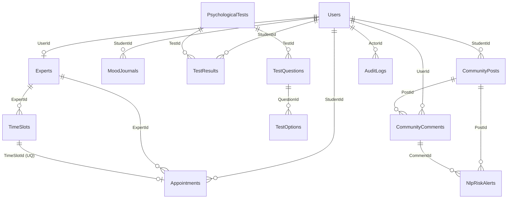

# 02. DATABASE ERD & DATA DICTIONARY
**Tài liệu theo chuẩn Sổ tay Quy trình AI Agent Web App 15 bước — B | Bước 10**  
**Dự án:** UniMind — Nền tảng Nhật ký Cảm xúc & Hỗ trợ Tư vấn Tâm lý Ẩn danh Dành cho Sinh viên  
**Học phần:** Phát triển Ứng dụng (PTUD) — ĐH Lạc Hồng  

---

## 1. Sơ đồ Quan hệ Thực thể (ERD Diagram)



---

## 2. Từ điển Dữ liệu (Data Dictionary)

### 2.1. Bảng `Users` (Người dùng hệ thống)
| Tên cột | Kiểu dữ liệu | Khóa / Ràng buộc | Ý nghĩa nghiệp vụ |
| :--- | :--- | :--- | :--- |
| `Id` | `UNIQUEIDENTIFIER` | PK, NOT NULL, DEFAULT NEWID() | Khóa chính định danh tài khoản |
| `MSSV` | `NVARCHAR(50)` | NULL | Mã số sinh viên (bảo mật, không trả ra API cộng đồng) |
| `FullName` | `NVARCHAR(150)` | NOT NULL | Họ và tên thật của người dùng |
| `Email` | `NVARCHAR(150)` | UNIQUE, NOT NULL | Địa chỉ email đăng nhập duy nhất |
| `PasswordHash` | `NVARCHAR(255)` | NOT NULL | Mật khẩu đã băm (BCrypt/Argon2) |
| `Role` | `NVARCHAR(30)` | NOT NULL, DEFAULT 'Student' | Vai trò: `Student`, `Expert`, `Admin` |
| `Faculty` | `NVARCHAR(100)` | NULL | Khoa: CNTT, Kinh tế, Dược, Ngôn ngữ... |
| `AvatarUrl` | `NVARCHAR(500)` | NULL | Đường dẫn ảnh đại diện trên Cloudinary |
| `AnonymousCode` | `NVARCHAR(50)` | NOT NULL | Bí danh bảo mật tự động: `"Bạn Ẩn Yên #382"` |
| `IsActive` | `BIT` | NOT NULL, DEFAULT 1 | Trạng thái kích hoạt tài khoản |
| `CreatedAt` | `DATETIME2` | NOT NULL, DEFAULT SYSUTCDATETIME() | Thời điểm tạo tài khoản |

### 2.2. Bảng `Appointments` (Lịch hẹn tư vấn)
| Tên cột | Kiểu dữ liệu | Khóa / Ràng buộc | Ý nghĩa nghiệp vụ |
| :--- | :--- | :--- | :--- |
| `Id` | `UNIQUEIDENTIFIER` | PK, NOT NULL | Khóa chính ca hẹn |
| `StudentId` | `UNIQUEIDENTIFIER` | FK -> `Users(Id)` | Sinh viên đặt lịch |
| `ExpertId` | `UNIQUEIDENTIFIER` | FK -> `Experts(Id)` | Chuyên viên được đặt |
| `TimeSlotId` | `UNIQUEIDENTIFIER` | FK -> `TimeSlots(Id)`, UNIQUE | **Chống trùng ca tư vấn (Anti-double-booking)** |
| `BookingCode` | `NVARCHAR(30)` | NOT NULL | Mã tra cứu ca hẹn (VD: `ST-8890`) |
| `AnonymousPseudonym` | `NVARCHAR(100)` | NOT NULL | Bí danh sinh viên hiển thị cho chuyên viên |
| `ConsultationType` | `NVARCHAR(30)` | NOT NULL, DEFAULT 'Physical' | Hình thức: `Physical` (P.302), `Online` (SafeCall) |
| `Status` | `NVARCHAR(30)` | NOT NULL, DEFAULT 'Pending' | Trạng thái: `Pending`, `Confirmed`, `Rejected`, `Completed` |
| `ReasonNotes` | `NVARCHAR(1000)`| NULL | Lý do và tâm sự ban đầu của sinh viên |
| `ClinicalNotes` | `NVARCHAR(MAX)` | NULL | Sổ tay ghi chép chuyên môn sau ca tư vấn |
| `IsMeetingActive` | `BIT` | NOT NULL, DEFAULT 0 | Trạng thái phòng họp trực tuyến đang mở |
| `MeetingStartedAt` | `DATETIME2` | NULL | Thời điểm chuyên viên bắt đầu phòng họp |

### 2.3. Bảng `MoodJournals` (Nhật ký cảm xúc)
| Tên cột | Kiểu dữ liệu | Khóa / Ràng buộc | Ý nghĩa nghiệp vụ |
| :--- | :--- | :--- | :--- |
| `Id` | `UNIQUEIDENTIFIER` | PK, NOT NULL | Khóa chính bài nhật ký |
| `StudentId` | `UNIQUEIDENTIFIER` | FK -> `Users(Id)` | Sinh viên sở hữu nhật ký |
| `MoodState` | `NVARCHAR(50)` | NOT NULL | Trạng thái: `Great`, `Peaceful`, `Stressed`, `Exhausted`, `Sad` |
| `EnergyLevel` | `INT` | NOT NULL, DEFAULT 5 | Mức năng lượng từ 1 đến 10 |
| `JournalContent` | `NVARCHAR(MAX)` | NOT NULL | Nội dung nhật ký riêng tư bảo mật |
| `SentimentScore` | `FLOAT` | NOT NULL, DEFAULT 0.0 | Điểm cảm xúc AI: -1.0 đến +1.0 |
| `SentimentLabel` | `NVARCHAR(50)` | NOT NULL, DEFAULT 'Neutral' | Nhãn cảm xúc: Positive, Neutral, Negative, Crisis |
| `AiAdvice` | `NVARCHAR(1000)`| NULL | Phản hồi thấu cảm & gợi ý bài tập thở từ AI |

### 2.4. Bảng `CommunityPosts` & `CommunityComments` (Diễn đàn & Bình luận)
- `CommunityPosts`: `Id`, `StudentId`, `AnonymousPseudonym`, `StudentRoleTag`, `Content`, `ImageUrl`, `ImageModerationStatus`, `CategoryTag`, `HasKeywordsAlert`, `SentimentScore`, `RiskScore`, `IsExtremeCrisis`, `IsSensitiveHiddenFromStudents`, `ModerationStatus`, `HugCount`, `EmpathyCount`, `CommentCount`, `CreatedAt`.
- `CommunityComments`: `Id`, `PostId`, `UserId`, `AuthorPseudonym`, `Content`, `ImageUrl` *(Mới - Đính kèm ảnh chuẩn FB)*, `IsExpertComment`, `ExpertTitle`, `IsSensitiveHiddenFromStudents`, `DetectedKeywords`, `ModerationStatus`, `CreatedAt`.

### 2.5. Bảng `NlpRiskAlerts` & `AuditLogs` (Báo động đỏ & Nhật ký kiểm toán)
- `NlpRiskAlerts`: `Id`, `PostId`, `CommentId`, `StudentAnonymousCode`, `Faculty`, `SnippetContent`, `TriggeredKeywords`, `RiskScore`, `TriageLevel` (`Urgent`, `High`, `Moderate`), `Status`, `InterventionAction`, `ResolvedBy`, `CreatedAt`.
- `AuditLogs`: `Id`, `ActionType`, `Details`, `ActorRole`, `ActorId`, `IpAddress`, `CreatedAt` *(Bất biến — Chỉ INSERT và SELECT)*.

---

## 3. Chiến lược Chỉ mục (Indexing Strategy) Tối ưu Hiệu năng
```sql
CREATE INDEX IX_Appointments_StudentId ON dbo.Appointments(StudentId);
CREATE INDEX IX_Appointments_ExpertId ON dbo.Appointments(ExpertId);
CREATE INDEX IX_Appointments_TimeSlotId ON dbo.Appointments(TimeSlotId);
CREATE INDEX IX_TimeSlots_ExpertId_Date ON dbo.TimeSlots(ExpertId, SlotDate);
CREATE INDEX IX_CommunityPosts_CreatedAt ON dbo.CommunityPosts(CreatedAt DESC);
CREATE INDEX IX_CommunityPosts_ModerationStatus ON dbo.CommunityPosts(ModerationStatus);
CREATE INDEX IX_CommunityComments_PostId ON dbo.CommunityComments(PostId);
CREATE INDEX IX_MoodJournals_StudentId_CreatedAt ON dbo.MoodJournals(StudentId, CreatedAt DESC);
CREATE INDEX IX_NlpRiskAlerts_Status ON dbo.NlpRiskAlerts(Status);
```
