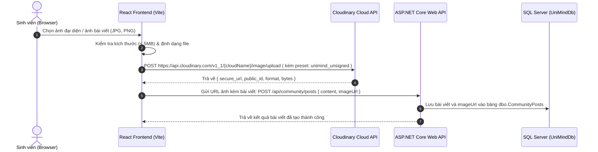

# HƯỚNG DẪN TÍCH HỢP & LƯU TRỮ HÌNH ẢNH TRÊN CLOUDINARY
### Dự án: Hệ thống Nhật ký Cảm xúc & Tư vấn Tâm lý Ẩn danh Dành cho Sinh viên (UniMind)
**Môn học:** Phát triển ứng dụng (PTUD) - GVHD: ThS. Lê Minh Nhật - ĐH Lạc Hồng  
**Nhóm thực hiện:** Ngô Tấn Lộc (MSSV: 120000212) - Lê Minh Luân (MSSV: 120000352)

---

## 1. Tổng quan & Mục tiêu lưu trữ hình ảnh
Trong hệ thống **UniMind**, có 2 phân hệ cần lưu trữ hình ảnh tải lên từ người dùng:
1. **Hình ảnh người dùng (User Profile):**
   - **Ảnh đại diện (Avatar):** Hiển thị tại hồ sơ cá nhân của sinh viên, chuyên viên tư vấn và quản trị viên.
   - **Hình nền cá nhân (Cover / Profile Banner):** Ảnh bìa trang cá nhân của người dùng.
2. **Hình ảnh bài viết cộng đồng (Community Post Attachments):**
   - Ảnh chụp minh họa cảm xúc, nhật ký vẽ tay, tranh tĩnh tâm hoặc hình ảnh học tập mà sinh viên chia sẻ ẩn danh lên diễn đàn SafeRoom.

### Vì sao chọn Cloudinary?
- **Gói miễn phí rộng rãi (Free Tier):** Cung cấp 25GB lưu trữ + 25GB băng thông/tháng (đủ cho toàn bộ quá trình báo cáo đồ án và chạy thử nghiệm thực tế).
- **CDN toàn cầu tốc độ cao:** Hình ảnh tải nhanh, độ trễ thấp trên cả máy tính và điện thoại.
- **Tự động tối ưu hóa (Auto Compression & Format):** Tự động chuyển đổi sang định dạng hiện đại (`WebP`, `AVIF`) với thông số `f_auto,q_auto`.
- **Cắt xén thông minh (Smart Face Crop):** Nhận diện khuôn mặt để tự động căn giữa avatar (`c_thumb,g_face,w_200,h_200`).
- **Bảo mật & Ẩn danh (Privacy-by-Design):** Tự động bóc tách và loại bỏ thông tin vị trí GPS/EXIF của camera sinh viên, đảm bảo tuân thủ nguyên tắc ẩn danh của môn học PTUD.

---

## 2. Các bước tạo tài khoản & Lấy thông tin cấu hình

### Bước 2.1: Đăng ký tài khoản miễn phí
1. Truy cập trang chủ Cloudinary: [https://cloudinary.com/users/register_free](https://cloudinary.com/users/register_free)
2. Điền thông tin cá nhân (Email, Mật khẩu) hoặc đăng nhập nhanh bằng Google/GitHub.
3. Sau khi xác nhận email, bạn sẽ được chuyển đến trang quản trị **Cloudinary Console (Dashboard)**.

### Bước 2.2: Lấy thông tin xác thực API
Tại trang **Dashboard (Console Settings)**, sao chép 3 thông số quan trọng sau:
- **Cloud Name:** Tên vùng lưu trữ đám mây của bạn (Ví dụ: `unimind-lhu`).
- **API Key:** Mã định danh API công khai (Ví dụ: `668128831581771`).
- **API Secret:** Khóa bí mật API dùng cho Backend (Ví dụ: `ddFKDKsyIeTy9vrflfc69Vjpfys`).

> [!CAUTION]
> **API Secret** chỉ được lưu trữ an toàn trong file `appsettings.json` hoặc biến môi trường ở Backend. **TUYỆT ĐỐI KHÔNG** đưa `API Secret` vào mã nguồn React / Frontend công khai.

### Bước 2.3: Tạo "Upload Preset" không ký tên (Unsigned Preset cho Frontend)
Để Frontend có thể upload ảnh trực tiếp lên Cloudinary mà không cần đưa `API Secret` ra ngoài:
1. Vào mục **Settings** (Biểu tượng bánh răng ở góc dưới bên trái console) -> Chọn tab **Upload**.
2. Cuộn xuống mục **Upload presets** -> Nhấp vào **Add upload preset**.
3. Cấu hình các mục như sau:
   - **Upload preset name:** Đặt tên gợi nhớ, ví dụ: `unimind_unsigned`.
   - **Signing Mode:** Chọn **Unsigned** (Rất quan trọng!).
   - **Folder:** Nhập thư mục gốc mặc định: `unimind_uploads`.
   - **Media analysis and AI:** (Tùy chọn) Bật lọc EXIF metadata.
4. Nhấn **Save** để lưu preset.

---

## 3. Quy ước tổ chức thư mục trên Cloudinary

Để dễ quản lý tài nguyên và kiểm duyệt, phân bổ thư mục trên Cloudinary như sau:
```
unimind_cloud/
├── avatars/          # Chứa ảnh đại diện người dùng và chuyên viên
├── banners/          # Chứa ảnh bìa / hình nền hồ sơ người dùng
└── post_images/      # Chứa hình ảnh sinh viên đính kèm bài viết cộng đồng
```

---

## 4. Phương án 1: Upload trực tiếp từ Frontend (React + Vite)
*(Khuyên dùng: Tốc độ upload nhanh nhất, giảm tải 100% băng thông và bộ nhớ cho máy chủ WebAPI)*



### 4.1. Tạo Helper Service `cloudinaryUpload.js`
Tạo file tại `frontend/src/shared/utils/cloudinaryUpload.js`:
```javascript
// frontend/src/shared/utils/cloudinaryUpload.js

const CLOUD_NAME = 'kh0hrw3c'; // Thay bằng Cloud Name của bạn
const UPLOAD_PRESET = 'unimind_unsigned';     // Thay bằng Upload Preset đã tạo

/**
 * Upload hình ảnh trực tiếp lên Cloudinary
 * @param {File} file - Đối tượng File từ input type="file"
 * @param {string} folder - Thư mục lưu trữ: 'avatars', 'banners', hoặc 'post_images'
 * @returns {Promise<{ url: string, publicId: string }>}
 */
export async function uploadImageToCloudinary(file, folder = 'post_images') {
  if (!file) throw new Error('Vui lòng chọn một tập tin ảnh.');

  // 1. Kiểm tra dung lượng (tối đa 5MB)
  const maxSize = 5 * 1024 * 1024;
  if (file.size > maxSize) {
    throw new Error('Dung lượng hình ảnh không được vượt quá 5MB.');
  }

  // 2. Kiểm tra định dạng ảnh
  const validTypes = ['image/jpeg', 'image/png', 'image/webp', 'image/gif'];
  if (!validTypes.includes(file.type)) {
    throw new Error('Chỉ chấp nhận các định dạng ảnh: JPG, PNG, WEBP, GIF.');
  }

  // 3. Chuẩn bị FormData
  const formData = new FormData();
  formData.append('file', file);
  formData.append('upload_preset', UPLOAD_PRESET);
  formData.append('folder', `unimind_cloud/${folder}`);

  // 4. Gửi HTTP Request lên Cloudinary
  const endpoint = `https://api.cloudinary.com/v1_1/${CLOUD_NAME}/image/upload`;
  const response = await fetch(endpoint, {
    method: 'POST',
    body: formData,
  });

  if (!response.ok) {
    const errorData = await response.json();
    throw new Error(errorData.error?.message || 'Upload ảnh lên Cloudinary thất bại.');
  }

  const data = await response.json();
  return {
    url: data.secure_url,       // URL HTTPS an toàn để lưu vào DB
    publicId: data.public_id,   // ID dùng khi cần xóa ảnh
    width: data.width,
    height: data.height,
  };
}
```

### 4.2. Component mẫu tải ảnh đính kèm bài viết (`PostImageUploader.jsx`)
```jsx
// frontend/src/features/community/components/PostImageUploader.jsx
import { useState, useRef } from 'react';
import { uploadImageToCloudinary } from '../../../shared/utils/cloudinaryUpload';

export default function PostImageUploader({ onImageUploaded, onRemoveImage, currentImageUrl }) {
  const [uploading, setUploading] = useState(false);
  const [error, setError] = useState(null);
  const fileInputRef = useRef(null);

  const handleFileChange = async (e) => {
    const file = e.target.files?.[0];
    if (!file) return;

    setError(null);
    setUploading(true);

    try {
      const result = await uploadImageToCloudinary(file, 'post_images');
      onImageUploaded(result.url);
    } catch (err) {
      setError(err.message || 'Lỗi tải ảnh lên.');
    } finally {
      setUploading(false);
      if (fileInputRef.current) fileInputRef.current.value = '';
    }
  };

  return (
    <div style={{ marginTop: 10 }}>
      {/* Nút bấm tải ảnh */}
      {!currentImageUrl && (
        <div>
          <input
            type="file"
            ref={fileInputRef}
            accept="image/*"
            style={{ display: 'none' }}
            onChange={handleFileChange}
          />
          <button
            type="button"
            className="admin-btn admin-btn-ghost"
            style={{ display: 'inline-flex', alignItems: 'center', gap: 6, fontSize: 13 }}
            onClick={() => fileInputRef.current?.click()}
            disabled={uploading}
          >
            {uploading ? '⏳ Đang tải ảnh lên Cloudinary...' : '📷 Thêm hình ảnh minh họa'}
          </button>
        </div>
      )}

      {/* Thông báo lỗi nếu có */}
      {error && (
        <div style={{ color: '#dc2626', fontSize: 12, marginTop: 4 }}>
          ⚠️ {error}
        </div>
      )}

      {/* Preview ảnh sau khi tải thành công */}
      {currentImageUrl && (
        <div style={{ position: 'relative', display: 'inline-block', marginTop: 8 }}>
          
          <button
            type="button"
            onClick={onRemoveImage}
            style={{
              position: 'absolute',
              top: 6,
              right: 6,
              background: 'rgba(0,0,0,0.6)',
              color: '#fff',
              border: 'none',
              borderRadius: '50%',
              width: 24,
              height: 24,
              cursor: 'pointer',
              display: 'flex',
              alignItems: 'center',
              justifyContent: 'center',
              fontSize: 12
            }}
            title="Xóa ảnh này"
          >
            ✕
          </button>
        </div>
      )}
    </div>
  );
}
```

---

## 5. Phương án 2: Upload qua Backend ASP.NET Core (.NET 8 Clean Architecture)
*(Khuyên dùng khi cần kiểm tra quyền hạn sinh viên, chống spam bot hoặc xóa ảnh cũ trước khi ghi đè)*

### 5.1. Cài đặt Package CloudinaryDotNet
Mở Terminal tại thư mục `backend/src/Infrastructure/` và chạy lệnh:
```bash
dotnet add package CloudinaryDotNet --version 1.26.2
```

### 5.2. Khai báo thông tin trong `appsettings.json`
Thêm mục cấu hình vào `backend/src/Presentation/WebAPI/appsettings.json`:
```json
{
  "Cloudinary": {
    "CloudName": "kh0hrw3c",
    "ApiKey": "668128831581771",
    "ApiSecret": "ddFKDKsyIeTy9vrflfc69Vjpfys"
  }
}
```

### 5.3. Khai báo Interface tại `Core/Application/Common/Interfaces/`
Tạo file `ICloudinaryService.cs` tại `backend/src/Core/Application/Common/Interfaces/`:
```csharp
namespace UniMind.Application.Common.Interfaces;

public interface ICloudinaryService
{
    /// <summary>
    /// Upload ảnh đại diện hoặc hình nền người dùng
    /// </summary>
    Task<string> UploadUserImageAsync(Stream fileStream, string fileName, string folderName = "avatars");

    /// <summary>
    /// Upload ảnh đính kèm bài viết cộng đồng
    /// </summary>
    Task<string> UploadPostImageAsync(Stream fileStream, string fileName);

    /// <summary>
    /// Xóa ảnh cũ trên Cloudinary thông qua URL
    /// </summary>
    Task<bool> DeleteImageByUrlAsync(string imageUrl);
}
```

### 5.4. Hiện thực Service tại `Infrastructure/ExternalServices/Cloudinary/`
Tạo file `CloudinaryService.cs` tại `backend/src/Infrastructure/ExternalServices/Cloudinary/`:
```csharp
using CloudinaryDotNet;
using CloudinaryDotNet.Actions;
using Microsoft.Extensions.Configuration;
using UniMind.Application.Common.Interfaces;

namespace UniMind.Infrastructure.ExternalServices.Cloudinary;

public class CloudinaryService : ICloudinaryService
{
    private readonly CloudinaryDotNet.Cloudinary _cloudinary;

    public CloudinaryService(IConfiguration configuration)
    {
        var cloudName = configuration["Cloudinary:CloudName"];
        var apiKey    = configuration["Cloudinary:ApiKey"];
        var apiSecret = configuration["Cloudinary:ApiSecret"];

        var account = new Account(cloudName, apiKey, apiSecret);
        _cloudinary = new CloudinaryDotNet.Cloudinary(account);
        _cloudinary.Api.Secure = true; // Luôn dùng giao thức HTTPS
    }

    public async Task<string> UploadUserImageAsync(Stream fileStream, string fileName, string folderName = "avatars")
    {
        var uploadParams = new ImageUploadParams
        {
            File = new FileDescription(fileName, fileStream),
            Folder = $"unimind_cloud/{folderName}",
            // Tự động căn chỉnh khuôn mặt và nén chất lượng cao
            Transformation = new Transformation()
                .Width(500)
                .Height(500)
                .Crop("thumb")
                .Gravity("face")
                .Quality("auto")
                .FetchFormat("auto")
        };

        var uploadResult = await _cloudinary.UploadAsync(uploadParams);
        if (uploadResult.Error != null)
        {
            throw new Exception($"Lỗi tải ảnh lên Cloudinary: {uploadResult.Error.Message}");
        }

        return uploadResult.SecureUrl.ToString();
    }

    public async Task<string> UploadPostImageAsync(Stream fileStream, string fileName)
    {
        var uploadParams = new ImageUploadParams
        {
            File = new FileDescription(fileName, fileStream),
            Folder = "unimind_cloud/post_images",
            // Giới hạn chiều rộng tối đa 1200px, giữ nguyên tỉ lệ gốc
            Transformation = new Transformation()
                .Width(1200)
                .Crop("limit")
                .Quality("auto")
                .FetchFormat("auto")
        };

        var uploadResult = await _cloudinary.UploadAsync(uploadParams);
        if (uploadResult.Error != null)
        {
            throw new Exception($"Lỗi tải ảnh bài viết lên Cloudinary: {uploadResult.Error.Message}");
        }

        return uploadResult.SecureUrl.ToString();
    }

    public async Task<bool> DeleteImageByUrlAsync(string imageUrl)
    {
        var publicId = ExtractPublicIdFromUrl(imageUrl);
        if (string.IsNullOrEmpty(publicId)) return false;

        var deleteParams = new DeletionParams(publicId);
        var result = await _cloudinary.DestroyAsync(deleteParams);
        return result.Result == "ok";
    }

    private static string? ExtractPublicIdFromUrl(string url)
    {
        try
        {
            var uri = new Uri(url);
            var path = uri.AbsolutePath;
            var uploadIndex = path.IndexOf("/upload/", StringComparison.Ordinal);
            if (uploadIndex < 0) return null;

            var afterUpload = path.Substring(uploadIndex + "/upload/".Length);
            // Bỏ qua version prefix v12345678/ nếu có
            if (afterUpload.StartsWith("v") && afterUpload.IndexOf('/') > 0)
            {
                afterUpload = afterUpload.Substring(afterUpload.IndexOf('/') + 1);
            }

            var lastDot = afterUpload.LastIndexOf('.');
            return lastDot > 0 ? afterUpload.Substring(0, lastDot) : afterUpload;
        }
        catch
        {
            return null;
        }
    }
}
```

### 5.5. Đăng ký DI trong `Program.cs`
Mở `backend/src/Presentation/WebAPI/Program.cs` và thêm:
```csharp
using UniMind.Infrastructure.ExternalServices.Cloudinary;

// Đăng ký dịch vụ Cloudinary
builder.Services.AddSingleton<ICloudinaryService, CloudinaryService>();
```

### 5.6. Tạo Controller Endpoint tiếp nhận Upload
Tạo `UploadController.cs` tại `backend/src/Presentation/WebAPI/Controllers/`:
```csharp
using Microsoft.AspNetCore.Mvc;
using UniMind.Application.Common.Interfaces;
using UniMind.Application.Common.Models;

namespace UniMind.WebAPI.Controllers;

[ApiController]
[Route("api/[controller]")]
public class UploadController : ControllerBase
{
    private readonly ICloudinaryService _cloudinaryService;
    private readonly IApplicationDbContext _context;

    public UploadController(ICloudinaryService cloudinaryService, IApplicationDbContext context)
    {
        _cloudinaryService = cloudinaryService;
        _context = context;
    }

    /// <summary>
    /// API Cập nhật Avatar người dùng
    /// </summary>
    [HttpPost("avatar")]
    public async Task<IActionResult> UploadAvatar([FromForm] IFormFile file, [FromQuery] Guid userId)
    {
        if (file == null || file.Length == 0)
            return BadRequest(new { message = "Vui lòng chọn file hình ảnh hợp lệ" });

        var user = _context.Users.FirstOrDefault(u => u.Id == userId);
        if (user == null)
            return NotFound(new { message = "Không tìm thấy người dùng" });

        // Xóa avatar cũ nếu có để tiết kiệm dung lượng Cloudinary
        if (!string.IsNullOrEmpty(user.AvatarUrl))
        {
            await _cloudinaryService.DeleteImageByUrlAsync(user.AvatarUrl);
        }

        using var stream = file.OpenReadStream();
        var secureUrl = await _cloudinaryService.UploadUserImageAsync(stream, file.FileName, "avatars");

        user.AvatarUrl = secureUrl;
        user.UpdatedAt = DateTime.UtcNow;
        await _context.SaveChangesAsync();

        return Ok(new { success = true, avatarUrl = secureUrl, message = "Cập nhật ảnh đại diện thành công!" });
    }

    /// <summary>
    /// API Upload ảnh đính kèm bài viết cộng đồng
    /// </summary>
    [HttpPost("post-image")]
    public async Task<IActionResult> UploadPostImage([FromForm] IFormFile file)
    {
        if (file == null || file.Length == 0)
            return BadRequest(new { message = "Vui lòng chọn file hình ảnh hợp lệ" });

        using var stream = file.OpenReadStream();
        var secureUrl = await _cloudinaryService.UploadPostImageAsync(stream, file.FileName);

        return Ok(new { success = true, imageUrl = secureUrl });
    }
}
```

---

## 6. Cập nhật và lưu trữ vào Cơ sở dữ liệu SQL Server

### 6.1. Cột lưu trữ ảnh trong SQL Server Schema (`database/schema.sql`)
1. **Bảng `dbo.Users` (Người dùng):**
   ```sql
   ALTER TABLE dbo.Users ADD AvatarUrl NVARCHAR(500) NULL;
   -- Nếu cần thêm hình nền người dùng:
   ALTER TABLE dbo.Users ADD BannerUrl NVARCHAR(500) NULL;
   ```
2. **Bảng `dbo.CommunityPosts` (Bài viết chia sẻ cộng đồng):**
   ```sql
   -- Đã được định nghĩa sẵn trong hệ thống UniMind:
   ImageUrl NVARCHAR(500) NULL,
   ImageModerationStatus NVARCHAR(50) DEFAULT 'None', -- None, Pending, Approved, Flagged, Rejected
   ImageModerationNote NVARCHAR(500) NULL
   ```

---

## 7. Các kỹ thuật tối ưu hóa hình ảnh chuẩn Clean Architecture

| Kỹ thuật | Cú pháp Cloudinary URL | Mục đích thực tế |
| :--- | :--- | :--- |
| **Tự động chọn định dạng** | `/f_auto/` | Chuyển thành WebP trên Chrome/Edge, AVIF trên Safari để tải siêu tốc |
| **Tự động nén chất lượng** | `/q_auto/` | Giảm dung lượng 60-80% mà mắt thường không nhận biết được sự suy giảm chất lượng |
| **Avatar tròn nhận diện mặt** | `/c_thumb,g_face,w_200,h_200,r_max/` | Tự động lấy trung tâm là khuôn mặt người dùng, bo tròn 100% |
| **Giới hạn bài viết** | `/c_limit,w_1000/` | Giới hạn chiều rộng ảnh chụp không vượt quá 1000px, phù hợp giao diện web |

---

## 8. Bảng kiểm tra hoàn thành (Checklist)

- [x] Đã đăng ký tài khoản Cloudinary và lấy `Cloud Name`, `API Key`, `API Secret`.
- [x] Đã tạo `Upload Preset` dạng **Unsigned** tên `unimind_unsigned` trên Cloudinary Console.
- [x] Tích hợp hàm `uploadImageToCloudinary` trong React Frontend để tải trực tiếp ảnh bài viết.
- [x] Kiểm tra URL trả về bắt đầu bằng `https://res.cloudinary.com/...` và lưu vào cột `ImageUrl` trong CSDL SQL Server.
- [x] Thử nghiệm xóa ảnh cũ khi đổi avatar người dùng để giải phóng bộ nhớ Cloudinary.
- [x] Đảm bảo tuân thủ nguyên tắc ẩn danh: Không đặt tên file chứa MSSV hoặc họ tên thật của sinh viên khi đẩy lên Cloud.

---
*Tài liệu được cập nhật tự động phục vụ báo cáo đồ án môn PTUD - Nhóm Tấn Lộc & Minh Luân.*
